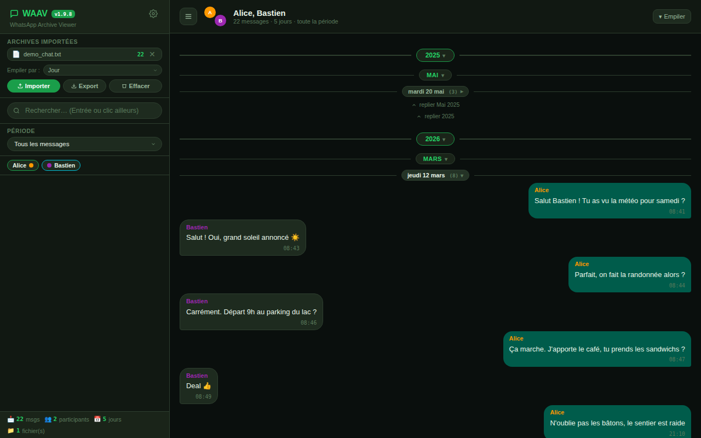
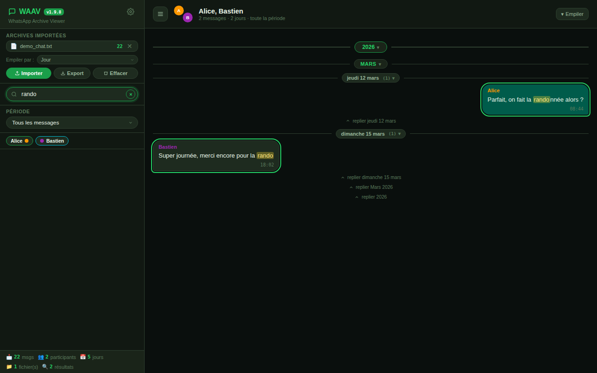

# 💬 WAAV — WhatsApp Archive Viewer

**Parcourez, fusionnez et recherchez vos archives de conversations WhatsApp, directement dans votre navigateur.**
Un seul fichier HTML, aucune installation, aucun compte, **aucune donnée envoyée sur Internet**.

> Les captures utilisent une conversation fictive.

---

## ✨ Fonctionnalités

**Import**
- Import d'un ou plusieurs exports WhatsApp `.txt` **ou d'une archive `.zip`** WhatsApp (seul le texte est lu, les médias sont ignorés), y compris de très grosses archives (100 000+ messages)
- Fusion de plusieurs archives avec **détection des doublons** (surlignés pour contrôle visuel, suppression sur confirmation)
- Réimport des exports JSON de WAAV

**Lecture**
- Conversation unifiée avec bulles façon WhatsApp, côté gauche / droite / masqué par participant
- Regroupement **Année → Mois → Jour**, repliable (réglable : par Mois, Jour, Année ou aucun)
- **Calendrier de période** à cases à cocher (Année › Mois › Semaine › Jour, sélections non contiguës, nombre de messages par ligne) ; l'ancien menu déroulant reste disponible dans ⚙ Réglages
- Affichage progressif (les bulles ne sont créées qu'à l'ouverture d'un groupe) pour rester fluide

**Recherche**
- Recherche par mot-clé avec surlignage, lancée avec Entrée ou en quittant le champ, effacée avec Échap ou le bouton ✕
- **« Voir toute la conversation »** : depuis un résultat, ouvre le visualiseur de jour (tous les messages de la journée, résultats surlignés), avec navigation jour précédent / suivant (boutons ou flèches ← →) et boutons « Précédent / Suivant » pour passer de résultat en résultat ; Échap ou « Retour aux résultats » pour revenir à la recherche, **« Aller à ce jour »** pour quitter la recherche et se placer sur ce jour dans la conversation générale
- Avertissement (fenêtre de confirmation) quand le nombre de résultats risque de ralentir l'affichage — **seuils réglables** dans ⚙ Réglages

**Assistant IA (option, désactivée par défaut)**
- Bascule « Conversations | IA » : résumés et questions sur la sélection (période et participants), avec un fournisseur au choix : **Ollama (local)**, **Mistral AI** ou **Claude** ; clé d'API au choix (session ou mémorisée), test de connexion, liste des modèles, jauge de jetons
- **Recherche ciblée** pour les très grosses archives : l'IA propose des mots-clés à partir de la question seule, WAAV cherche et compte lui-même, n'envoie que les passages trouvés, et cite des dates cliquables
- Demandes **suspendables et reprenables** (enregistrées au fil de l'eau, export / import d'état), historique des échanges conservé, export `.md`
- **Recherche par le sens** (option, téléchargement du modèle sur accord explicite, calcul dans le navigateur, index séparé) : zone de recherche « Mots | Sens », utilisable sans IA, et source de passages pour la recherche ciblée
- Rien n'est envoyé sans confirmation, et seulement les messages sélectionnés

**Conservation**
- Les archives sont gardées dans le navigateur (IndexedDB) : à la réouverture, WAAV propose de **reprendre**, démarrer sans charger ou effacer
- Détection des anciennes bases laissées par des versions précédentes, suppression uniquement sur demande

**Export**
- JSON (réimportable), TXT au format WhatsApp (réimportable), SQLite (`.db`), MySQL (`.sql`, utf8mb4, importable dans phpMyAdmin) ; **nom du fichier au choix** et option **compression en `.zip`** (réimportable pour TXT et JSON)

---

## 🚀 Utilisation

### En ligne (GitHub Pages)
Ouvrez l'adresse de la page du projet : `https://VOTRE-UTILISATEUR.github.io/waav/`
*(remplacez par l'adresse de votre dépôt une fois la publication activée)*

### En local
1. Téléchargez [`index.html`](index.html) et **renommez-le `waav.html`**
2. Placez-le dans un dossier de votre choix et ouvrez-le avec votre navigateur
3. Glissez-y vos fichiers `.txt` exportés depuis WhatsApp

### Exporter une conversation depuis WhatsApp
Sur Android : dans la conversation, menu **⋮ › Plus › Exporter la discussion**. Sur iPhone : nom du contact en haut de la conversation › **Exporter la discussion**. Choisissez **Sans médias**, puis récupérez le fichier `.txt`.
Formats de date reconnus : `JJ/MM/AAAA, HH:MM - Expéditeur: message`, variantes avec « à HH:MM », format `[date]`, séparateurs `/`, `-`, `.`.

---

## 🔒 Confidentialité

- **Par défaut, vos conversations ne quittent jamais votre ordinateur** : elles sont lues et stockées uniquement dans votre navigateur. Il n'y a pas de serveur.
- **Par défaut, aucune ressource externe** : les polices et la bibliothèque sql.js (export SQLite) sont intégrées au fichier. WAAV ne contacte aucun serveur et fonctionne hors connexion.
- **Deux options facultatives, désactivées par défaut, changent cela, uniquement sur votre demande** : l'**assistant IA** envoie à l'IA de votre choix les messages sélectionnés, après confirmation (avec **Ollama**, tout reste sur votre machine ; avec Mistral ou Claude, ils sont transmis à ces services) ; la **recherche par le sens** télécharge un moteur de calcul (cdn.jsdelivr.net) et un modèle (huggingface.co) après un message d'information, sans envoyer aucun message.
- **Ne publiez jamais de vraies conversations** dans un dépôt public : le fichier `.gitignore` fourni exclut les formats courants (`.txt`, `.json`, `.db`, `.sql`).

---

## 💾 Stockage : à connaître

Les archives sont enregistrées **dans le navigateur de l'appareil**, pas dans le fichier HTML.

- **Vider les données du navigateur efface vos archives.** Faites de temps en temps un **Export → JSON**.
- **En usage local (`file://`), le navigateur lie les données au chemin complet du fichier** (c'est le cas de Firefox). Pour retrouver vos données d'une version à l'autre : gardez **le même nom (`waav.html`) et le même dossier**, et remplacez simplement le fichier par la nouvelle version. WAAV affiche dans ⚙ Réglages › « Stockage lié à » l'adresse utilisée et avertit si le nom diffère.
- **En ligne ou via un serveur à adresse fixe**, toutes les versions servies par la même adresse partagent le même stockage, quel que soit le nom du fichier.

---

## 🛠️ Technique

- HTML5, CSS3, JavaScript « vanilla », IndexedDB — un seul fichier (environ 840 Ko, polices et sql.js compris), pas de dépendance de build
- Composants tiers intégrés : voir [THIRD-PARTY-NOTICES.md](THIRD-PARTY-NOTICES.md)
- Bases IndexedDB : `wa_archive` (archives), `waav_ia` (demande IA en pause) et `waav_sem` (index de la recherche par le sens) ; réglages dans le `localStorage`
- Navigateurs récents (l'export SQLite, la compression zip et la lecture des zip demandent Firefox 113+ ou Chrome 80+). Développé et testé sur Chromium et utilisé sous Firefox ; les autres navigateurs modernes devraient fonctionner mais n'ont pas été vérifiés. La recherche par le sens demande un navigateur moderne (WebAssembly) et un ordinateur récent pour indexer vite.

L'historique du développement (versions, demandes, choix techniques, fonctionnalités abandonnées) est dans **[HISTORIQUE.md](HISTORIQUE.md)** ; le détail des anciennes versions est archivé dans [docs/HISTORIQUE-ARCHIVE.md](docs/HISTORIQUE-ARCHIVE.md). Le changelog est aussi consultable dans l'application en cliquant sur le numéro de version.

---

## 🗺️ Feuille de route

- **v2.2 à v2.4** ✅ : assistant IA (Ollama, Mistral, Claude), calendrier de période, import / export zip, demandes reprenables, recherche ciblée, recherche par le sens
- **v2.4.1** ✅ : aide aux mots-clés plus pertinente (nettoyage, mots fréquents grisés, « Compléter avec l'IA », suggestions par le thème et par le sens)
- **v2.4.2** ✅ : recherche avancée sans IA (casse, mot entier, jokers, ET / OU / SAUF, expressions, regex), onglet Statistiques (qui lance la discussion, temps de réponse, activité par heure, comptage par personne), orientation des questions de calcul
- Ensuite : validation de la recherche par le sens sur tous les systèmes, marque-pages, affichage des médias, synchronisation MySQL (API PHP)

---

## 🤝 Contribuer

Les suggestions et corrections sont les bienvenues : ouvrez une *issue* ou une *pull request*.
En contribuant, vous acceptez que votre contribution soit publiée sous la même licence (GPL-3.0-or-later).
Conseils pour contribuer : partir de la dernière version stable, un seul changement fonctionnel à la fois, vérifier la syntaxe JavaScript, mettre à jour le changelog intégré **et** `HISTORIQUE.md`.

---

## 👥 Crédits

- **Concept original :** R&R (Régori & Rabrielle)
- **Développement :** Claude (Anthropic)

## 📄 Licence

**[GNU GPL v3 ou ultérieure](LICENSE)** (`GPL-3.0-or-later`) — logiciel libre.

Vous pouvez utiliser, étudier, modifier et redistribuer WAAV, y compris l'héberger sur votre propre site. Si vous distribuez une version (modifiée ou non), elle doit rester sous la même licence, avec son code source disponible : le code de WAAV reste libre.

WAAV n'est ni affilié, ni approuvé par WhatsApp ou Meta. WhatsApp est une marque de Meta Platforms, Inc.
